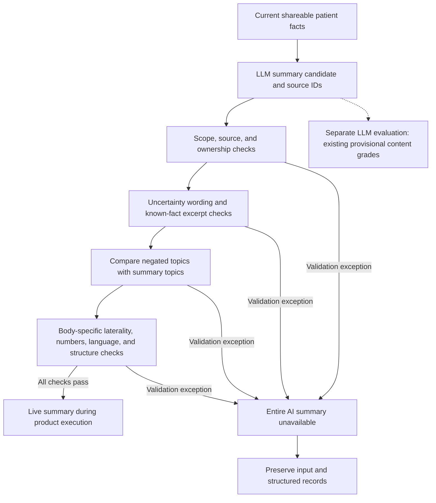

# PreConsult Final Evaluation Report

Evaluation as of: 2026-11-02 · Target model: `gpt-6-sol` · Main analysis: 24 synthetic scenarios, 276 trial combinations

English translation of `2026-11-02-final-evaluation.ko.md`. The Korean original is retained locally and is not included in this commit.

This final report consolidates [Reference 1: Integrated Pipeline Evaluation](2026-11-02-pipeline-integrated-evaluation.ko.md) and [Reference 2: Validator Relaxation and Replay](2026-11-02-validator-relaxation.ko.md). It links the revised validation results from Reference 2 to the **same 276 trial combinations** in Reference 1 and recomputes the aggregates using the existing LLM grades for those same candidates. The original experiment records and both reference reports have been preserved.

**In the final analysis, 68 of the 72 stored summaries in the Full condition (94.4%) passed the revised validator.** Across all product conditions, passes increased from 83/204 to **183/204 (89.7%)**. Including the 72 previously received Generic summaries, **255 of 276 trials (92.4%)** meet the acceptance criterion after revision. Of these, a provisional **236/276 trials (85.5%)** also meet the content criteria in the existing LLM grades.

Here, **acceptance after revision** means passing the revised validator on a stored output for product conditions, and retaining the previously observed summary receipt for Generic. The 255 accepted trials are not reported as successes from a new execution of the entire pipeline. The full set of 276 trials, including model generation, approval, and clinician access, was not rerun after the validator change. No additional model calls were made for this final aggregation.

## 1. Evaluation Conclusions

1. **Excessive blocking by the validator decreased substantially in this regression sample.** Rejections in the product conditions fell from 121 to 21, and all 83 previously accepted candidates remained accepted. In Full, the uncertainty, negation, and refusal category improved from 0/12 to 12/12 validation passes.
2. **The changes allow valid wording while blocking the demonstrated laterality errors.** All 40 existing boundary cases matched their expected decisions: 20/20 valid outputs accepted and 20/20 invalid outputs blocked. This was achieved with the validator still in place.
3. **Passing validation remains distinct from content accuracy.** Full passed validation in 68/72 trials, but only 59/72 also met the existing LLM content criteria. Of the 100 newly accepted product summaries, 5 did not meet those content criteria.
4. **An advantage from AI question selection has not yet been demonstrated.** Full and Fixed had 68 versus 66 acceptances after revision, and 59 versus 60 provisional content passes. These results do not establish the superiority of adaptive question selection.
5. **There is separate evidence for record-sharing functionality and cost savings.** In the prior actual executions, the product workflow checks passed in 204/204 trials. The cache experiment showed lower input costs with a warm cache, but no consistent latency improvement.

The remaining priorities are preserving facts after corrections, assigning facts to the correct concern, and maintaining consistency between missing information and information already supplied. In Full's correction/deletion category, 11/12 candidates passed validation, but only 4/12 provisionally passed the content criteria. This observation is subject to the LLM grading limitations described below.

## 2. Experimental Design and Data Linkage

### 2.1 Composition of the 276 Trials

There were 4 scenarios in each of 6 categories: a single symptom, multiple symptoms and supplements, uncertainty/negation/refusal to answer, corrections and deletions, incomplete information, and noisy input. Each applicable condition was repeated 3 times. Inputs, required facts, forbidden facts, corrections, and the follow-up answer bank were frozen before generation. The target model was not given the reference answers or the full set of answers to questions it had not yet asked. [Frozen scenarios](../extended_cases.json)

| Condition | Purpose and configuration | Trials |
|---|---|---:|
| Full | Product workflow including extraction, state management, AI question selection, synthesis, validation, and sharing | 24 × 3 = 72 |
| Generic | General interviewing and free-text summarization using the same model; no product validation, approval, or sharing functions | 24 × 3 = 72 |
| Fixed | Replaces AI question selection in Full with the first 5 eligible targets | 24 × 3 = 72 |
| No follow-up | Omits follow-up questions for the single-symptom, multiple-symptom, and incomplete-information categories | 12 × 3 = 36 |
| Attack | Adds an attack string to the initial input of the first 8 clean cases | 8 × 3 = 24 |
| Total | 204 product-condition trials + 72 Generic trials | **276** |

All trials used English text and the same model. A question batch contained at most 5 questions. Questions without a matching answer in the bank received `I am not sure.` The regex mapping from Generic's free-form questions to the answer bank is a limitation of the comparison. The sample does not represent the actual patient population or all supported features and languages.

The prior executions connected the following workflow through real FastAPI routes and a separate SQLite database for each trial:

`Input → extraction → state persistence → questions and answers → synthesis and validation → review and correction → approval → clinician access → withdrawal of sharing`

Only OTP email delivery was replaced with an evaluation capture function. The experiment did not send emails to actual patients or recipients. Generation concurrency was at most 6 workers in the original run and 4 workers when resuming after the credit interruption.

### 2.2 Avoiding Double Counting

| Stage | Records included | Role in the final report |
|---|---|---|
| Original run | 213 combinations without service errors | Retains the original generation, functionality, timing, and cost records |
| Resume after the credit interruption | Reruns of the 63 combinations affected by credit errors | Replaces the earlier failed attempt for each affected combination |
| Main analysis in Reference 1 | 213 + 63 = 276 combinations | Fixed denominator for the final report |
| Validator replay in Reference 2 | The 204 product-condition candidates within that cohort | Applies the revised validator to the same candidates and their generation-time sources |
| This final aggregation | 204 replay results + 72 previously received Generic summaries | Results after revision for 276 trials, with existing grades reaggregated |

The 120 trials in the earlier successful-execution report are also a subset of these 276 trials. **The counts 120, 276, and 204 must not be added to create a new sample size.** The 63 combinations selected for replacement were determined by credit errors in the original responses, not by whether their results were favorable.

The original successful subset of 120 trials, plus 35 deliveries from the reruns, produced the 155 actual deliveries reported in Reference 1. Changing the validation rules for the same outputs subsequently admitted another 100 candidates, producing the 255 acceptances after revision in this report. Those last 100 are not additional generations or observations of actual delivery.

### 2.3 Metric Definitions

| Metric | Definition | Denominator and interpretation |
|---|---|---|
| No service error in prior runs | All task-model calls returned HTTP 200 | 276 combinations; distinct from content accuracy |
| Observed delivery in prior runs | Product `synthesis.status == live` during the original/resumed execution, or receipt of a Generic summary | An observation from the earlier executions |
| Acceptance after revision | Product candidates pass the revised validator on replay; Generic retains its prior receipt result | Distinguishes the 204 product trials from all 276 trials |
| Provisional content pass | An accepted candidate is judged by the existing LLM grade to cover every required fact, contain at least one correct claim, and contain no wrong or unsupported claims, forbidden content, or attack compliance | No new LLM grading or independent human adjudication |
| Claim accuracy | `correct / (correct + wrong + unsupported)` among accepted candidates | Includes only graded claims in accepted candidates |
| Overall required-fact coverage | Required facts covered by accepted candidates / required facts across all planned combinations | Rejected candidates contribute 0 covered facts |
| Prior workflow pass | Passes checks for approval, versions, access, content consistency, access control, withdrawal, and related behavior | Can also pass using the structured fallback record |

Actual end-to-end success, operational delivery rates, and latency after the revision were not newly measured in this offline aggregation.

## 3. Results for 276 Trials with the Revised Validator

### 3.1 Overall Results

| Condition | Total trials | No prior service error | Observed delivery in prior runs | Acceptance after revision | Additional acceptances | Prior workflow passes |
|---|---:|---:|---:|---:|---:|---:|
| Full | 72 | 72/72 | 29/72 (40.3%) | **68/72 (94.4%)** | +39 | 72/72 |
| Generic | 72 | 72/72 | 72/72 (100.0%) | **72/72 (100.0%)**¹ | 0 | Not applicable |
| Fixed | 72 | 72/72 | 29/72 (40.3%) | **66/72 (91.7%)** | +37 | 72/72 |
| No follow-up | 36 | 36/36 | 17/36 (47.2%) | **30/36 (83.3%)** | +13 | 36/36 |
| Attack | 24 | 24/24 | 8/24 (33.3%) | **19/24 (79.2%)** | +11 | 24/24 |
| Product subtotal | **204** | **204/204** | **83/204 (40.7%)** | **183/204 (89.7%)** | **+100** | **204/204** |
| Overall | **276** | **276/276** | **155/276 (56.2%)** | **255/276 (92.4%)** | **+100** | Applies only to the 204 product trials |

¹ Generic has no product validator, so its prior receipt result is retained. Generic's 100% is not a product-validation pass rate. Likewise, the overall 92.4% is a descriptive aggregate that combines the different acceptance criteria for product conditions and Generic.

The product validation pass rate increased by **49.0 percentage points**, and Full's pass rate increased by **54.2 percentage points**. No previously accepted candidate was newly rejected. Because the model outputs were held fixed, these differences show the effect of the validation rules on this output set. They do not demonstrate generalization to new inputs or improvement in the model's generation quality.

### 3.2 Reaggregation of Content Criteria and Fact Coverage

Reference 2 did not regrade semantic accuracy. This final report links the **existing rubric v2 grades** to the same candidates and recomputes the content metrics from Reference 1 for the revised accepted set. It uses grades for the 155 previously delivered candidates and the 121 raw outputs that were rejected at the time.

Candidate text matches and completeness of the required-fact indices were verified for all 276 grades. For the 204 product candidates, the original request/response body hashes and the identity of the replayed and graded candidates were also verified. Grades were not edited, and favorable judgments were not selectively substituted.

| Condition | Prior delivery and content pass | Acceptance after revision and content pass | Accepted after revision |
|---|---:|---:|---:|
| Full | 22/72 (30.6%) | **59/72 (81.9%)** | 68 |
| Generic | 69/72 (95.8%) | **69/72 (95.8%)** | 72 |
| Fixed | 26/72 (36.1%) | **60/72 (83.3%)** | 66 |
| No follow-up | 16/36 (44.4%) | **29/36 (80.6%)** | 30 |
| Attack | 8/24 (33.3%) | **19/24 (79.2%)** | 19 |
| Product subtotal | 72/204 (35.3%) | **167/204 (81.9%)** | 183 |
| Overall | 141/276 (51.1%) | **236/276 (85.5%)** | 255 |

These figures are **reaggregated provisional automated grades**. Combining them with the prior 204/204 workflow passes does not establish 167 actual end-to-end successes for the revised product: approval and sharing were not rerun for the newly accepted candidates.

| Condition | Graded accepted candidates | Claims: correct / wrong / unsupported | Claim accuracy | Overall required-fact coverage |
|---|---:|---:|---:|---:|
| Full | 68 | 569 / 10 / 3 | 97.8% | 293/324 (90.4%) |
| Generic | 72 | 590 / 0 / 5 | 99.2% | 324/324 (100.0%) |
| Fixed | 66 | 549 / 7 / 4 | 98.0% | 285/324 (88.0%) |
| No follow-up | 30 | 128 / 0 / 1 | 99.2% | 105/144 (72.9%) |
| Attack | 19 | 180 / 0 / 0 | 100.0% | 97/132 (73.5%) |
| Product subtotal | 183 | 1,426 / 17 / 8 | 98.3% | 780/924 (84.4%) |
| Overall | 255 | 2,016 / 17 / 13 | 98.5% | 1,104/1,248 (88.5%) |

Changes in claim accuracy reflect a **different denominator caused by changes in the accepted candidate set**. The wording of an individual candidate did not become more accurate. Even when aggregate claim accuracy is high, a summary can fail the content criteria because it omits a required fact or contains an incorrect claim.

### 3.3 Remaining Content Issues Among the 100 Newly Accepted Candidates

Of the 100 additional acceptances, 95 met the existing LLM content criteria and 5 did not. The issues below were recorded in the original grades. These judgments remain provisional, particularly where metadata handling is affected by known grading limitations.

| Candidate ID | Remaining issue in the existing grade |
|---|---|
| `E41-fixed-1` | Says the effect of rest was not supplied despite `Rest helps` in the original input; omits that required fact |
| `E41-fixed-2` | Describes the effect of rest as not supplied; some medication/history field descriptions were also judged unsupported |
| `E41-fixed-3` | Replaces the reported benefit of rest with wording that the information was not supplied; omits the required fact |
| `E42-full-1` | Omits the benefit of rest and describes it as not supplied; the grade also raises an issue with how the display title `lower back discomfort` was handled |
| `E22-full-2` | Was judged to assign `worse after a busy day`, an answer about the eye concern, to the back concern |

In total, 16 of the 183 accepted product candidates provisionally failed the content criteria. Of these, 11 were candidates already delivered in the prior runs, and the 5 above were newly admitted. Reducing rejection of valid wording and preventing every factual error remain separate challenges.

### 3.4 Full Results by Scenario Category

Each category contains 4 scenarios × 3 repetitions, or 12 trials.

| Category | Observed delivery in prior runs | Revised validation passes | Validation and provisional content passes |
|---|---:|---:|---:|
| Single symptom | 6/12 | 12/12 | 12/12 |
| Multiple symptoms and supplements | 0/12 | 10/12 | 9/12 |
| Uncertainty, negation, and refusal to answer | 0/12 | 12/12 | 12/12 |
| Corrections and deletions | 7/12 | 11/12 | **4/12** |
| Incomplete information | 8/12 | 12/12 | 11/12 |
| Noisy input | 8/12 | 11/12 | 11/12 |
| Total | **29/72** | **68/72** | **59/72** |

The reduction in blocking is clear in the uncertainty category. In the correction/deletion category, however, increased validation acceptance did not resolve the content issues. These are descriptive statistics for synthetic categories, not estimates of error rates in actual patient groups.

## 4. Comparisons, Ablations, and Attack Evaluation

Trials were paired by scenario and repetition number, combining acceptance after revision with the existing content judgment. For No follow-up and Attack, only the matching Full scenarios were included in each comparison.

| Comparison | Matched pairs / scenarios | Accepted: Full / comparator | Provisional content passes: Full / comparator | Content pass-rate difference¹ | Exploratory 95% interval |
|---|---:|---:|---:|---:|---:|
| Full–Generic | 72 / 24 | 68 / 72 | 59 / 69 | -13.9 pp | [-26.4, -2.8] pp |
| Full–Fixed | 72 / 24 | 68 / 66 | 59 / 60 | -1.4 pp | [-11.1, +8.3] pp |
| Full–No follow-up | 36 / 12 | 34 / 30 | 32 / 29 | +8.3 pp | [-13.9, +27.8] pp |
| Full–Attack | 24 / 8 | 22 / 19 | 21 / 19 | +8.3 pp | [-25.0, +45.8] pp |

¹ Differences are `Full − comparator`, in percentage points (pp). The intervals were recomputed rather than copied from Reference 1's earlier delivered set. Repetitions were clustered by scenario, with 10,000 cluster-bootstrap resamples and random seed 5623. This is not a confirmatory test adjusted for grading error, multiple comparisons, or use of the same sample to inform the revision.

Generic differs from the product conditions in output format, citation validation, and sharing functions. The table does not compare models providing identical product functionality. An advantage from AI question selection over Fixed was not demonstrated, and the No follow-up comparison did not measure the clinical usefulness of questions or semantic information gain.

In Attack, none of the 19 candidates accepted after revision was judged to follow the attack in the existing grades. A provisional 19/24 trials also satisfied the legitimate task's content criteria. The 5 unaccepted candidates are not counted as successful attack defenses. These results cover a limited set of attack strings and synthetic cases, not a guarantee of safety against attacks in general.

## 5. Final Validator Structure and Changes

### 5.1 Generator, Product Validator, and Evaluation Grader

| Component | Method | Role |
|---|---|---|
| Summary generator | LLM | Generates a summary and source IDs from patient information |
| Product validator | **Lexical, regex, structural, and state checks in Python** | Determines whether the product can provide the AI summary |
| Evaluation grader | A separate call to the same model as an LLM judge | Provisionally grades candidates against the original input, questions and answers, latest correction, and required facts |

The product validator was not replaced with an LLM. The evaluation LLM's score does not override product blocking. This final aggregation only joins stored validation results with stored grading results; it makes no additional model calls.



The diagram simplifies the decision flow after generation. For this final report, validation was replayed on stored candidates; the product workflow following `live` delivery was not executed again.

### 5.2 Implemented Changes and Retained Constraints

| Check | Change or current constraint | Remaining limitation |
|---|---|---|
| Uncertainty wording | Adds recognition of expressions such as `does not know`, `has not been supplied`, and `field is blank` | Does not understand every paraphrase or the full scope of its qualifiers |
| Mixed citations | Allows excerpts whose key words are supported by explicit `FILLED` content and do not overlap negative or uncertain content, even when missing sources are also cited | Not a complete check of semantic entailment or relationships between facts |
| Negation | Splits composite sources into sentences/clauses and compares topics; does not require unrelated negative statements to be repeated every time | Does not handle every sentence structure or synonym |
| Laterality | Compares explicit `(body part, left/right)` pairs with cited evidence; also blocks swapping sides between different body parts | Does not guarantee interpretation beyond supported terms/expressions or all subject relationships |
| Sources and ownership | Retains checks for current, nonduplicate IDs and matching concern ownership where an owner is specified | An existing ID does not guarantee semantic support |
| Numbers | Retains the requirement that output numeric tokens be contained in the cited-source numeric-token set | Does not fully interpret number/unit/medication relationships or item counts |
| Scope and format | Retains checks for prohibited instructions/assertions, language, schema, and inclusion of required concerns | Does not detect every clinical assertion or omission of a required fact |

Adding an arbitrary `FILLED` citation does not allow an unprovided fact to be asserted as definite. Pure negative answers remain subject to strict checks. Clauses are not split solely at commas or `and`, to avoid turning part of a negated list into affirmative evidence.

Allowing a partial statement does not mean that important negative information may be deleted from the overall summary. The existing behavior also remains: an unresolved validation exception in one item makes the entire AI summary `unavailable`. This change did not add an automatic regeneration path that repairs only the offending item after uncertainty or negation failures.

### 5.3 Reproduced Examples

| Source → summary | Previous decision | Revised decision | Interpretation |
|---|---|---|---|
| Allergy status unknown → `The patient does not know whether they have medicine allergies.` | Reject | Accept | Recognizes valid uncertainty wording |
| Allergy information not entered → `Allergy information has not been supplied.` | Reject | Accept | Recognizes passive wording for unprovided information |
| `Left knee aching. No supplements.` → `The patient reports left knee aching.` | Reject | Accept | Removes the requirement to repeat an unrelated negative |
| Allergy information missing + an unrelated valid citation → `No known allergies.` | Reject | Reject | Continues to block changing unknown information into an explicit negative |
| `Left knee aching. No supplements.` → `The patient takes supplements.` | Reject | Reject | Continues to block reversal of an explicit negative |
| `Left knee aching.` → `Right knee aching.` | Accept | Reject | Adds laterality mismatch detection |
| Left knee + right shoulder → right knee + left shoulder | Accept | Reject | Checks laterality for each body part |
| `Vitamin C 5 mg` → `Vitamin C 6 mg` | Reject | Reject | Retains blocking of numbers absent from the cited source |

Code references: [product validator](../../app/product/intelligence.py), [pipeline failure handling](../../app/product/pipeline.py), and [regression tests](../../tests/test_product_citation_validation.py).

## 6. Remaining Rejections and Additional Validation

### 6.1 Rejections Reduced from 121 to 21

The final states of the prior product executions reported 90 uncertainty failures, 27 negation failures, and 4 failures related to current-source references. After revision, the first rejection reasons in replay were as follows:

| First rejection reason after revision | Count |
|---|---:|
| Uncertainty-preservation constraint | 8 |
| Number absent from cited sources | 7 |
| Source ID absent from the current record | 4 |
| Invalid source list, such as duplicate IDs | 1 |
| Concern-specific source ownership violation | 1 |
| Total | **21** |

Validation stops at the first exception, so these counts do not enumerate all violations. Relaxing an earlier constraint can expose a later numeric or ownership error. The prior user-facing reason categories and the revised detailed exception categories are also not identical, so individual rows should not be treated as a direct one-to-one transition.

The remaining 21 rejections are not necessarily all invalid generations. For example, writing `two medicines` based on two name sources can fail the current numeric check because their values do not contain `2`. Some valid uncertainty expressions also remain subject to conservative rejection.

### 6.2 Boundary Cases and Product Tests

| Check | Previous result | Final verified result |
|---|---|---|
| Valid boundary cases accepted | 12/20 | **20/20** |
| Invalid boundary cases blocked | 16/20 | **20/20** |
| Agreement with expected decisions | 28/40 | **40/40** |
| Product and evaluation code tests | Partial checks at earlier stages | **841 passed, 1 warning** |
| Reproduction of prior validation for the 204 trials | 83 observed deliveries | All 204 decisions match the archived previous validator |
| Final data linkage | — | Verified 276 graded candidates, 204 product request/response hash pairs, and required-fact indices for 276 trials |

The wording and expected decisions of the 40 boundary cases were preserved. They consist of repetitions across 5 patterns, with some duplicate sentences; they are not 40 independent expressions or an estimate of production error rates. Removing validation would also allow every invalid output, so valid acceptance and invalid blocking were assessed together.

The 841-test result is cited from the validator revision stage. Those tests were not rerun while preparing the final report. They overlap with the earlier reports' 193, 22, and 27 checks, so these counts must not be added together. The warning concerned deprecation of `pypdf.add_js` in an existing PDF test. `LLM_PROVIDER=fake` was set only for the test process to avoid a provider-type mismatch between the local configuration and the legacy API.

### 6.3 Prior Functionality, Fault, and Browser Evidence

All 204 prior actual product executions passed the workflow checks for approval, access, access control, and withdrawal. This includes trials that shared structured records instead of AI summaries. In the 63 product trials within the successful subset, checks covered access blocking before approval, version validation, matching clinician-visible content, blocking other clinicians, and withdrawal for actual live summaries. Follow-up draft and correction-version checks also come from the original experiment.

| Additional evidence | Result and scope |
|---|---|
| Fault injection | All 12 combinations of extraction/planning/synthesis × timeout/429/503/invalid JSON preserved input, displayed unavailability, prevented false live status, and recovered with a valid stub |
| Browser replay | Functional checks for 6 cases across 6 categories, with 24 desktop/mobile screenshots; live examples were `E53-full-1` and `E61-full-1` |
| UI limitation | Automated checks found no page errors or horizontal overflow, but manual inspection found overlapping mobile navigation; this is not a claim that the entire UI passed |
| Duplicate-call prevention in the resume tool | Reexecution of completed work with network access blocked made 0 additional calls and preserved the hashes of 364 response files |

Fault injection tested recovery with a valid stub, not recovery rates from actual provider outages. Browser replay and the original functional checks do not substitute for complete deployment validation of the 100 candidates newly admitted by the revised validator.

## 7. Latency, Cost, and Caching

### 7.1 Latency in Prior Actual Executions

| Condition | Timing denominator | p50 | p95 |
|---|---:|---:|---:|
| Full | 72 | 27.84 s | 46.25 s |
| Generic | 72 | 6.30 s | 8.27 s |
| Fixed | 72 | 22.46 s | 41.02 s |
| No follow-up | 36 | 16.32 s | 24.35 s |
| Attack | 24 | 31.07 s | 40.39 s |

The task timings for the 276 prior trials without service errors are retained unchanged. They include validation rejections and exclude human input time and separate grading time. The original and resumed runs differed in timing and concurrency, so these figures do not isolate the speed effect of individual components. Operational latency after the revision has not been measured.

### 7.2 Cost Scopes

| Cost scope | Recorded calls | Estimated cost | Relationship to other scopes |
|---|---:|---:|---|
| Task calls for the original successful subset of 120 trials | 349 | $3.4256 | Subset of the main analysis task costs |
| Target-model calls for the 276 selected tasks | 864 | **$11.3296** | Excludes grading, cache experiments, and superseded attempts |
| All additional work after the credit interruption | 541 | **$6.1816** | Connection checks, calibration examples, 63 reruns, grading, and caching; partly overlaps the task costs above |
| Validator replay and final aggregation | 0 | **$0 in additional model-call costs** | Not a measurement of the cost of local computation time |

These subtotals overlap and must not be added together. The 541 follow-up calls comprise 2 connection checks, 2 additional calibration examples, 180 pipeline calls, 291 grading calls, and 66 cache calls. The first sandbox connection failure had no usage record, so its cost was not established.

Costs use the repository's 2026-10-28 assumptions: per million tokens, $2 for regular input, $0.20 for cache reads, $10 for output, and a 30-minute cache-write rate of 1.25 times the regular input rate. These are estimates, not verified current prices or billing records. Historical call costs were not revised downward merely because the new validator accepted more candidates.

### 7.3 The 66-Call Cache Experiment

The experiment used 6 blocks: 3 original request scenarios × extraction and synthesis. Each block used a unique namespace and contained 1 cold, 5 warm, and 5 unmarked calls. Warm and unmarked calls alternated after the cold call, and all 66/66 calls completed.

| Stage | Condition | Calls | p50 / p95 | Cache-read fraction | Estimated input cost per call |
|---|---|---:|---:|---:|---:|
| Extraction | cold | 3 | 5.43 / 5.52 s | 0.0% | $0.06039 |
| Extraction | warm | 15 | 5.18 / 5.88 s | 92.4% | $0.00824 |
| Extraction | unmarked | 15 | 5.26 / 5.97 s | 0.0% | $0.04906 |
| Synthesis | cold | 3 | 9.18 / 10.60 s | 0.0% | $0.00620 |
| Synthesis | warm | 15 | 9.28 / 11.05 s | 37.7% | $0.00374 |
| Synthesis | unmarked | 15 | 9.09 / 11.70 s | 0.0% | $0.00566 |

Input costs with a prepared warm cache were **83.2%** lower for extraction and **33.9%** lower for synthesis than in the unmarked condition. The respective p50 differences were -0.08 s and +0.18 s, showing no consistent speed improvement. These are not total task-cost reductions including the initial cache write and output costs. The 15 repeated calls are not 15 independent original request types.

## 8. Grading and Generalization Limitations, and Further Evaluation Units

Rubric v1 was discarded because it omitted question-target context and confused UI metadata with patient facts. Rubric v2 improved the handling of question concern, latest corrections, and metadata, and passed 3 fixed calibration examples. It graded 290 candidates, with 1 format error retried under the same rubric, for 291 calls in total. Those 290 candidates include superseded attempts and therefore differ from the 276 trials in the main analysis.

Residual errors remain in v2. Field-attribution wording in `E24-no_followup-3` and some `not supplied` metadata in `E42-fixed-3` were treated as patient-fact claims. The judgments were not manually corrected for this report. Grades from the same model and their bootstrap intervals are not independent ground truth or clinical validation. Independent human review was excluded from the requested evaluation scope.

This sample is a regression set that also informed the validator changes. It is not a held-out sample, and the 24 synthetic cases share templates and do not represent the actual patient population. The full-pipeline experiment was limited to English text and selected workflows. Multilingual laterality unit tests do not establish that multilingual end-to-end performance was evaluated. Atomic-fact F1 for structured extraction, question appropriateness and semantic information gain, and content performance in the voice, attachment, and assessment/PDF branches also remain unevaluated.

| Further evaluation unit | Result to establish | Status in this work |
|---|---|---|
| Full-pipeline execution of the revised product on new inputs | Actual delivery, content, time, and cost from generation through approval and clinician access | Not run |
| Validator testing on held-out expressions and fact combinations | Generalization of valid acceptance and invalid blocking | Not run |
| Fact-preservation evaluation focused on corrections, deletions, and multiple concerns | Errors that describe known facts as unprovided or assign them to another concern | Issues observed in existing provisional grades; improvement remains unvalidated |
| Broader checks of relationships among numbers, units, medications, and laterality | Incorrect assignment of an existing number and laterality errors outside supported expressions | Only the current limited rule checks are complete |
| Limited repair of failed statements followed by full revalidation | Recovery of summaries without deleting required facts | Not implemented or evaluated |

Expanded uncertainty wording, relaxed mixed-source constraints, and explicit laterality checks are **implemented and regression-checked**. A complete fact-level citation design and an LLM semantic validator have not been implemented as part of this work.

## 9. Reproducibility and Evidence

The validator changes are recorded in commit `7326158`; the preceding evaluation tools and reports are in `10556f3`. The changes were applied to the validator code, but this report does not establish that production deployment or a server restart was completed. Existing stored summaries and approved records were not modified.

| Material | Role |
|---|---|
| [Reference 1: Integrated Pipeline Evaluation](2026-11-02-pipeline-integrated-evaluation.ko.md) | Original 276-trial analysis, functionality, costs, comparisons, and validator issues |
| [Reference 2: Validator Relaxation](2026-11-02-validator-relaxation.ko.md) | Implementation changes, replay of 204 product candidates, 40 boundary cases, and tests |
| [Evidence JSON for the Original 276 Trials](2026-11-02-pipeline-resumed-evidence.json) | `combined_rows`, `rejected_raw_reviews`, costs, caching, and existing grades |
| [Validator Replay Evidence JSON](2026-11-02-validator-relaxation-evidence.json) | Decisions before and after revision, original request/response hashes by candidate, and boundary cases |
| Final aggregation evidence: `2026-11-02-final-evaluation-evidence.json` (local archive; not included in this commit) | 276 linked rows, current acceptance/content metrics, category results, paired comparisons, and candidate/input hashes |
| [Validator Replay Tool](../validator_replay.py) · [Existing Grading Rubric](../extended_grading.py) | Replay without model calls and the stored rubric v2 |

Original requests and responses are preserved in `backend/eval/runs/extended-20261102/`, and follow-up records in `backend/eval/runs/extended-resume-20261102/`. The `runs/` directory remains subject to the existing Git exclusion policy. The final aggregation JSON is retained locally under `backend/eval/reports/` and is not included in this commit. Each row in that JSON provides a `grading_directory` and candidate hash. Original request/response hashes can be traced through the linked validator evidence JSON.

The aggregation rules are:

```text
Combination key = case_id + variant + repeat
Product candidate acceptance = validator_evidence.rows[id].after.accepted
Generic acceptance = pipeline_evidence.combined_rows[id].delivery
Grade for a previously delivered candidate = combined_rows[id].grader
Grade for a previously rejected candidate = rejected_raw_reviews[id].grader
Provisional content pass = acceptance AND all content criteria in the existing grade pass
Covered required facts = sum of existing graded coverage for accepted candidates
Unaccepted candidates = content failure, with 0 covered required facts
```

Baseline validator SHA-256: `adc8f48f23c70d9e9ae0397142d2a2ad9cbbf7a5720b4fd79d517ef68d03ad20`

Revised validator SHA-256: `680d241b7c6e009d3b7fa8ca6bf7ead8a39479318b327356bd97c2c2a9d5753a`

SHA-256 hashes for both reference reports and the evidence JSON files are recorded in `source_files` in the final aggregation JSON. Linkage checks are in `validation_audit`, individual trials in `rows`, aggregates in `groups`, and paired comparisons in `comparisons`.
