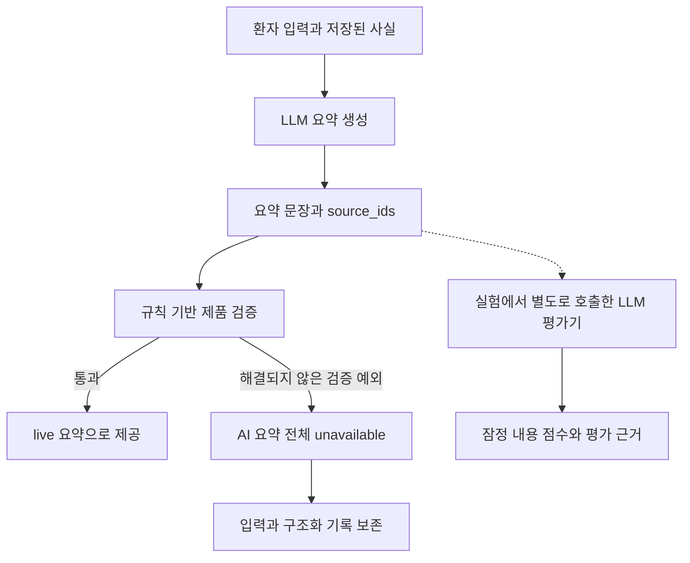

# PreConsult 파이프라인 평가 통합 보고서와 제품 검증기 분석

평가 실행일: 2026-11-02 · 모델: `gpt-6-sol` · 문서 성격: 기존 실행 결과의 통합·해석

이 문서는 [성공 실행 기록 보고서](2026-11-02-pipeline-evaluation-success-only.ko.md)와 [비용 중단 항목 후속 실험 보고서](2026-11-02-pipeline-resumed-evaluation.ko.md)를 통합한다. 두 보고서의 분모를 구분하고, 실제 제품 코드와 저장된 경계사례를 근거로 검증기의 판정 구조·예시·문제점을 추가했다. 이 문서를 작성하기 위한 추가 모델 호출이나 제품 코드 수정은 수행하지 않았다.

**전체 파이프라인의 판단에는 후속 실험으로 보완한 276건을 사용한다.** 성공 보고서의 120건은 그 안에 포함된 부분집합이다. 현재 Full 조건은 72건 모두 모델 서비스 오류 없이 실행됐지만, AI 요약 전달은 29건(40.3%)이었다. 제품 조건 전체에서는 승인·조회·철회 기능이 204/204건 통과한 반면, AI 요약은 83/204건 전달됐다. 기록 공유 기능의 완료와 AI 요약 전달은 서로 다른 결과다.

가장 뚜렷한 문제는 **규칙 기반 제품 검증기가 일부 올바른 표현을 거절하면서, 일부 의미 오류는 통과시킨다는 점**이다. 별도 LLM 평가기의 내용 점수도 잔여 채점 오류가 있어 잠정치로 취급한다.

## 1. 두 보고서의 관계와 집계 기준

| 자료 | 대상과 목적 | 통합본에서의 사용 |
|---|---|---|
| 성공 실행 기록 | 원실행 중 서비스 오류가 없고 최종 요약 전달까지 완료한 120건. 제품 조건은 기능 흐름 통과도 요구 | 성공 경로의 구체적 기능 확인과 해당 부분집합의 시간·비용 |
| 후속 실험 | 원래 서비스 오류가 없던 213건을 유지하고, 크레딧 영향을 받은 63개 조합을 별도 재실행으로 교체 | 전체 276개 조합의 전달률·기능 결과·잠정 내용 점수·대응 비교 |
| 추가 검사 | 검증기 경계사례, 장애 주입, 브라우저 재생, 도구 테스트 | 위 생성 실행 수에 합산하지 않는 별도 근거 |

`원실행 276개 조합 = 서비스 오류 없는 213개 + 크레딧 영향 63개`

`통합 주 분석 276개 조합 = 기존 213개 + 해당 조합의 재실행 63개`

교체 대상은 후속 결과를 보기 전에 원본의 `credit_balance_exhausted` 응답으로 고정했다. 정상 실행이 제품 검증에 의해 요약을 전달하지 못한 경우는 그대로 유지했다. 따라서 좋은 출력만 골라 기존 결과를 교체한 분석이 아니다. 원래 기록도 삭제하지 않았다.

### 1.1 성공 120건과 최종 전달 155건의 연결

| 조건 | 기존 성공 부분집합 | 재실행에서 추가 전달 | 주 분석의 최종 전달 | 주 분석 전체 실행 |
|---|---:|---:|---:|---:|
| Full | 25 | 4 | 29 | 72 |
| Generic | 57 | 15 | 72 | 72 |
| Fixed | 21 | 8 | 29 | 72 |
| No follow-up | 10 | 7 | 17 | 36 |
| Attack | 7 | 1 | 8 | 24 |
| 합계 | **120** | **35** | **155** | **276** |

성공 120건은 주 분석 276건의 일부이므로 **120 + 276을 새 표본 수로 계산하지 않는다.** 여기서 전달은 내용 정확도나 임상적 타당성을 보증하지 않는다. 성공 보고서에서 의미 채점이 미완료라고 설명한 것은 당시 상태이며, 통합본에서는 후속 rubric v2의 잠정 점수를 사용한다.

## 2. 실험 설계와 성공의 정의

합성 시나리오는 단일 증상, 다중 증상·보충제, 불확실성·부정·응답 거절, 수정·삭제, 정보 부족, 잡음 입력의 6유형 × 4개로 구성했다. 같은 조합을 3회 반복했다. 입력·정정·필수 사실·후속 답변 은행은 생성 전에 고정했고, 정답 목록이나 숨겨진 답변 전체를 대상 모델에 제공하지 않았다. 영어 텍스트와 동일 모델을 사용했다. [고정 사례](../extended_cases.json)

| 조건 | 변경점 | 실행 수 |
|---|---|---:|
| Full | 현재 추출·상태 관리·AI 질문 선택·요약·검증·공유 경로 | 24 × 3 = 72 |
| Generic | 별도 일반 문진·자유문 요약 프롬프트. 제품 검증·승인·공유 경로 없음 | 24 × 3 = 72 |
| Fixed | Full에서 AI 질문 선택을 eligible targets의 앞 5개 선택으로 대체 | 24 × 3 = 72 |
| No follow-up | 단일·다중·정보 부족 유형에서 추가 질문 생략 | 12 × 3 = 36 |
| Attack | 첫 8개 정상 사례의 초기 입력에 공격 문구 추가 | 8 × 3 = 24 |

실제 FastAPI route와 실행별 SQLite DB를 사용하고, 모델 출력이 다음 단계 상태에 반영되도록 연결했다. 추가 질문과 정정은 해당 조건·시나리오에 있을 때 수행했다.

`입력 → 추출 → 상태 저장 → 질문·답변 → 요약·검증 → 검토·정정 → 승인 → 의료진 조회 → 공유 철회`

OTP 이메일 발송은 평가용 수신 함수로 대체했다. 제품의 인증·역할·소유권·승인 route는 실제 코드를 사용했다. 원실행의 생성 동시성은 최대 6개, 후속 실행은 최대 4개 프로세스였다.

| 용어 | 판정 기준 | 포함하지 않는 의미 |
|---|---|---|
| 서비스 오류 없음 | 자동 채점을 제외한 과제 모델 호출이 모두 HTTP 200 | 생성 내용이 정확함 |
| 요약 전달 | 제품의 최종 `synthesis.status == live`, 또는 Generic의 최종 요약 수신 | 모든 필수 사실과 의미가 정확함 |
| 기능 흐름 통과 | 승인·버전·의료진 조회·내용 일치·접근 제어·철회 검사 통과 | AI 요약이 반드시 전달됨. 구조화 대체 기록도 기능 흐름을 통과할 수 있음 |
| 자동 채점상 내용 성공 | 요약 전달, 필수 사실 전부 포함, 오류·근거 없는 주장·금지 정보·공격 추종 없음 | 독립 사람 검토나 임상 검증 완료 |
| 제품의 내용 기준 E2E 성공 | 내용 성공과 기능 흐름 통과를 함께 만족 | 실제 환자 모집단의 안전성·유효성 입증 |

## 3. 전체 276건의 관측 결과

### 3.1 전달과 기능 흐름

| 조건 | 실행 수 | HTTP 오류 없는 실행 | 최종 요약 전달 | 자동 채점상 내용 성공¹ | 기능 흐름 통과 |
|---|---:|---:|---:|---:|---:|
| Full | 72 | 72 | 29/72 (40.3%) | 22/72 (30.6%) | 72/72 |
| Generic | 72 | 72 | 72/72 (100.0%) | 69/72 (95.8%) | 해당 없음 |
| Fixed | 72 | 72 | 29/72 (40.3%) | 26/72 (36.1%) | 72/72 |
| No follow-up | 36 | 36 | 17/36 (47.2%) | 16/36 (44.4%) | 36/36 |
| Attack | 24 | 24 | 8/24 (33.3%) | 8/24 (33.3%) | 24/24 |

¹ 내용 점수는 §3.2의 한계를 가진 잠정 자동 채점치다. 제품 조건의 기능 흐름이 모두 통과했으므로 이 표본에서는 내용 성공 수와 제품의 내용 기준 E2E 성공 수가 같다. Generic에는 제품의 기능 흐름 점수를 적용하지 않는다.

Full과 Fixed의 요약 전달은 각각 29/72건이었다. Generic은 동일 모델을 사용하지만 제품의 인용 검증·승인·공유 경로가 없고 자유문 출력이므로, 전달 차이를 모델 자체의 성능 차이로 해석하지 않는다.

### 3.2 자동 의미 채점 결과와 한계

기존 후보 227건과 재실행 후보 63건, 총 290개 후보를 수정 기준으로 채점했다. 여기에는 사용자에게 전달되지 않은 원출력도 포함된다. 290은 채점 작업 수이며 주 분석의 실행 조합 수 276과 다르다. 원실행과 재실행의 같은 조합을 주 분석에 중복 포함하지 않았다.

전체 채점 전에 고정 예제 3개로 질문 대상·최신 정정·메타데이터 분리, 허위 수치·불확실성, 삭제 정보 재등장을 점검했다. 필수 사실 판정 배열이 비어 있던 `E54-generic-3` 한 건은 같은 기준으로 다시 채점해 최종 인덱스 완전성을 확인했다. 따라서 실제 채점 호출은 291회다. 이전 rubric v1은 사용하지 않았다.

| 조건 | 채점된 전달 요약 | 주장 수: 정확 / 오류 / 근거 없음 | 주장 정확도 | 전체 과제 필수 사실 포함 |
|---|---:|---:|---:|---:|
| Full | 29 | 201 / 8 / 2 | 95.3% | 85/324 (26.2%) |
| Generic | 72 | 590 / 0 / 5 | 99.2% | 324/324 (100.0%) |
| Fixed | 29 | 205 / 3 / 3 | 97.2% | 83/324 (25.6%) |
| No follow-up | 17 | 74 / 0 / 1 | 98.7% | 59/144 (41.0%) |
| Attack | 8 | 67 / 0 / 0 | 100.0% | 32/132 (24.2%) |

주장 정확도의 분모는 **전달된 요약에서 채점한 사실 주장**이다. 필수 사실 포함률의 분모는 **모든 예정 조합의 고정 필수 사실**이며, 미전달 요약의 포함 수는 0으로 계산했다. 두 비율은 분모가 다르다.

**LLM 평가기의 점수를 정답으로 확정하지 않는다.** `E24-no_followup-3`의 필드 귀속 표현, `E42-fixed-3`의 일부 `not supplied` 설명을 환자 사실 주장으로 취급한 잔여 문제가 관찰됐다. 같은 모델을 별도 호출하는 채점이며 독립 사람 검토가 아니다. 유리한 결과만 수동으로 고치지 않았고, 원채점과 근거를 보존했다.

### 3.3 비교·구성요소 제거·공격

다음은 전체 대응 조합의 내용 성공 비교다. 성공 사례만 골라 비교한 표가 아니다. 차이는 `Full − 비교 조건`이며 pp는 퍼센트포인트다.

| 비교 | 대응 쌍 / 시나리오 | 성공 건수: Full / 비교 | 차이 | 탐색적 95% 구간 |
|---|---:|---:|---:|---:|
| Full–Generic | 72 / 24 | 22 / 69 | -65.3 pp | [-77.8, -51.4] pp |
| Full–Fixed | 72 / 24 | 22 / 26 | -5.6 pp | [-15.3, +6.9] pp |
| Full–No follow-up | 36 / 12 | 13 / 16 | -8.3 pp | [-27.8, +8.3] pp |
| Full–Attack | 24 / 8 | 6 / 8 | -8.3 pp | [-20.8, +0.0] pp |

시나리오별 반복을 묶어 10,000회 복원 추출한 군집 부트스트랩 구간이다(난수값 5623). 채점 오류의 불확실성이나 다중 비교 보정은 포함하지 않는다. 합성 시나리오가 생성 틀을 공유하므로 실제 모집단의 우월성 검정으로 해석하지 않는다.

성공 보고서의 양쪽 성공 대응 쌍은 각각 20·11·5·4쌍이었다. 그 표는 완료된 실행의 시간·답변 수를 설명하는 보조 자료이며, 전체 대응 비교와 분모를 섞지 않는다. 후속 질문으로 얻은 답변 수는 임상적 유용성이나 새로운 정보의 정확한 보존을 평가한 지표가 아니므로 No follow-up 결과만으로 추가 질문이 불필요하다고 결론 내릴 수 없다.

Attack에서는 전달 후 채점된 8건 중 공격 추종 판정이 0건이었고, 전체 24건 중 정상 과제까지 함께 성공한 수는 자동 채점상 8건이었다. 미전달 16건을 공격 방어 성공으로 계산하지 않았다.

## 4. 성공 실행에서 확인한 기능과 추가 검사

기존 성공 부분집합의 제품 63건에서는 최종 live 요약 전달과 함께 승인 전 접근 차단, 잘못된 버전 승인 거절, 현재 버전 승인, 의료진 조회 시 버전·AI 문장 일치, 다른 의료진 접근 차단, 공유 철회와 철회 후 접근 차단을 확인했다. 후속 답변이 있는 53건에서는 초안이 제출 전 사실 상태에 반영되지 않았고, 정정이 있는 12건에서는 요약 버전이 증가했다. 이 검사 수들은 같은 실행에 중복 적용되므로 합산하지 않는다.

Full의 `E13`, `E53`은 각각 반복 1·2·3 모두 기존 성공 기준을 충족했다. 이 두 고정 사례의 반복 완료 기록이며 전체 조건의 안정성 추정치는 아니다.

| 추가 검사 | 확인한 결과 | 해석 범위 |
|---|---|---|
| 검증기 경계사례 | 성공 보고서에 발췌한 기대 판정 일치 28건 | 전체 40건의 일부이며 나머지 문제는 §7에서 함께 분석 |
| 기존 원출력 재생 | `N02 / call-0006`, `N04 / call-0013` 검증 통과 | 새 모델 생성이 아닌 기존 출력 재생 |
| 장애 주입 | 추출·질문 생성·요약 × timeout·429·503·잘못된 JSON, 12조건 통과 | 입력 보존·unavailable 표시·거짓 live 방지·정상 응답 대역으로 복구. 실제 공급자 복구율 측정 아님 |
| live 결과의 브라우저 재생 | `E53-full-1`, `E61-full-1`에서 환자 승인·의료진 조회·synthesis 일치 | 실제 frontend·API·DB 사용, 재생 중 모델 호출 비활성화. 화면 배치 전체의 통과 판정 아님 |
| 코드·실행기 검사 | 기존 관련 테스트 193개, 이후 평가 테스트 22개, 후속 도구 테스트 27개 통과 | 시점별 실행에 중복 검사 포함. 합산하지 않음 |
| 재개 시 중복 호출 방지 | 완료 상태에서 네트워크 차단 후 재개해 추가 호출 0, 응답 파일 364개 해시 유지 | 완료 작업의 재사용과 원자료 보존 확인 |

## 5. 시간·비용·캐시 결과

### 5.1 기존 성공 부분집합 120건

아래는 **성공 120건만의** 과제 시간과 비용이다. 자동 채점과 사람의 입력 시간은 제외했다. Generic은 제품의 승인·공유 단계를 포함하지 않는다.

| 조건 | 시간·비용 분모 | p50 | p95 | 대상 모델 호출 | 추정 비용 소계 | 실행당 추정 평균 |
|---|---:|---:|---:|---:|---:|---:|
| Full | 25 | 26.71초 | 48.14초 | 114 | $1.5326 | $0.0613 |
| Generic | 57 | 6.37초 | 8.11초 | 114 | $0.2018 | $0.0035 |
| Fixed | 21 | 22.30초 | 41.45초 | 73 | $1.0035 | $0.0478 |
| No follow-up | 10 | 16.66초 | 22.31초 | 20 | $0.3092 | $0.0309 |
| Attack | 7 | 27.16초 | 30.66초 | 28 | $0.3786 | $0.0541 |
| 합계 | **120건** | — | — | **349회** | **$3.4256** | **$0.0285** |

이 349회 호출에서 입력 3,513,669토큰, 출력 175,658토큰, 입력 중 캐시 읽기 2,976,869토큰을 기록했다. 전체 276건의 비용이나 운영 성공률로 사용하지 않는다.

### 5.2 전체 주 분석 표본의 시간

다음 표에는 제품 검증 거절 실행도 포함한다. §5.1과 표본이 다르므로 p50·p95 차이를 성능 개선량으로 계산하지 않는다.

| 조건 | 시간 분모 | p50 | p95 |
|---|---:|---:|---:|
| Full | 72 | 27.84초 | 46.25초 |
| Generic | 72 | 6.30초 | 8.27초 |
| Fixed | 72 | 22.46초 | 41.02초 |
| No follow-up | 36 | 16.32초 | 24.35초 |
| Attack | 24 | 31.07초 | 40.39초 |

시간은 원실행·후속 실행의 서로 다른 실행 시각과 병렬 처리 조건을 포함한다. 사람의 생각·입력 시간과 별도 자동 채점 시간은 제외했다. 분위수는 정렬한 관측값의 위치 `(n−1) × p`에서 선형 보간했다.

### 5.3 캐시 비교 66회

3개 시나리오의 추출·요약 요청 6묶음에 대해, 묶음별 고유 namespace로 cold 1회, unmarked 5회, warm 5회를 실행했다. 최초 요청 뒤에는 unmarked와 warm을 번갈아 호출했다. 같은 묶음에서 명시적 캐시 경계 외의 본문은 동일하다.

| 단계 | 조건 | 호출 수 | p50 | p95 | 입력 중 캐시 읽기 비율 | 호출당 추정 입력 비용 |
|---|---|---:|---:|---:|---:|---:|
| 추출 | cold | 3 | 5.43초 | 5.52초 | 0.0% | $0.06039 |
| 추출 | warm | 15 | 5.18초 | 5.88초 | 92.4% | $0.00824 |
| 추출 | unmarked | 15 | 5.26초 | 5.97초 | 0.0% | $0.04906 |
| 요약 | cold | 3 | 9.18초 | 10.60초 | 0.0% | $0.00620 |
| 요약 | warm | 15 | 9.28초 | 11.05초 | 37.7% | $0.00374 |
| 요약 | unmarked | 15 | 9.09초 | 11.70초 | 0.0% | $0.00566 |

warm의 호출당 추정 입력 비용은 unmarked 대비 추출에서 **83.2%**, 요약에서 **33.9%** 감소했다. p50 차이(warm − unmarked)는 추출 **−0.08초**, 요약 **+0.18초**였다. 비용 절감은 관측됐지만 일관된 속도 향상은 확인하지 못했다.

이 비용 차이는 이미 캐시가 준비된 반복 요청의 **입력 비용** 비교다. 최초 쓰기와 출력 비용을 포함한 전체 과제 절감률이 아니다. 단계별 원요청은 3묶음이므로 반복 15회를 독립 요청 15종으로 세지 않는다.

### 5.4 비용 범위의 구분

| 작업 | 기록된 호출 | 입력 토큰 | 출력 토큰 | 추정 비용 소계 | usage·가격 누락 호출 |
|---|---:|---:|---:|---:|---:|
| API 연결·정상 채점 예제 | 2 | 490 | 242 | $0.0034 | 1 |
| 오류·삭제 채점 예제 | 2 | 1,012 | 627 | $0.0083 | 0 |
| 파이프라인 재실행 | 180 | 2,381,138 | 115,858 | $2.3872 | 0 |
| 수정 기준 채점 | 291 | 275,346 | 152,195 | $2.0726 | 0 |
| 캐시 비교 | 66 | 902,836 | 50,976 | $1.7100 | 0 |
| 합계 | **541** | — | — | **$6.1816** | — |

위 표는 후속 실행 폴더의 **추가 수행 비용 $6.1816**이다. 원본 비용을 포함하지 않는다. 기존 성공 부분집합의 $3.4256과 단순히 합쳐 전체 평가 비용이라고 부르면 원본의 다른 실행·채점 등이 빠진다.

참고로 주 분석에서 채택한 276개 과제 기록 자체의 대상 모델 호출만 후속 근거 JSON의 조건별 `budget`에서 합산하면 **864회, $11.3296**이다. 이는 본 통합본에서 재집계한 분석 표본의 비용으로, 채점·캐시·교체 전 과제 등을 포함한 전체 실험 지출과 다르다. 이 금액에는 §5.1의 성공 부분집합과 후속 파이프라인 비용이 포함돼 있으므로 다른 소계와 더하지 않는다.

모든 비용은 2026-10-28 저장소 가격 가정(백만 토큰당 일반 입력 $2, 캐시 읽기 $0.20, 출력 $10, 30분 캐시 쓰기 입력 단가의 1.25배)을 사용한 추정치다. 현재 가격이나 청구서 검증값이 아니다. usage 없는 최초 샌드박스 연결 실패는 소계에 포함되지 않으며 비용을 확정하지 않았다.

## 6. 제품 검증기의 판정 구조

### 6.1 제품 검증기와 평가용 LLM의 구분

| 구성요소 | 방식 | 역할 | 제품의 전달 여부를 직접 결정하는가 |
|---|---|---|---|
| 요약 생성기 | LLM | 환자 입력·저장된 사실로 요약과 근거 ID 생성 | 출력 후보 생성 |
| 제품 검증기 | **Lexical 검사 + 구조·상태 검사**를 결합한 Python 규칙 | 형식·근거·숫자·표현·주제 범위 확인 | **그렇다** |
| 실험용 평가기 | 같은 모델을 별도로 호출하는 LLM judge | 원입력·질문과 답변·최신 정정·필수 사실을 기준으로 잠정 채점 | 아니다. 저장된 결과를 별도 평가 |

제품 검증기는 문장 의미를 별도의 LLM에 물어 통과시키는 구조가 아니다. 정규표현식, 근거 ID 조회, 상태값, 숫자 집합, 응답 구조 등의 결정적 검사로 동작한다.



도식은 요약 생성 이후의 경로를 단순화한 것이다. 정정 미해결 등의 사전 차단 분기는 생략했다. LLM 평가기의 점수가 제품의 차단을 해제하거나 실제 사용자에게 전달할 내용을 바꾸지는 않는다.

### 6.2 검사 내용

| 검사 | 현재의 대략적인 판정 | 보장하지 못하는 부분 |
|---|---|---|
| 텍스트·범위 | 문자열·길이, 금지 표현·주입 지시·일부 마크업 검사 | 모든 의미적 범위 위반 탐지 |
| 근거 형식·존재 | source_ids가 비어 있지 않고 중복·잘못된 ID가 없는지 확인 | 해당 ID의 내용이 문장을 의미상 뒷받침하는지 |
| 증상 소유 관계 | `concern_summaries`처럼 owner를 전달한 항목에서 근거의 concern_id 일치 확인 | 모든 섹션·문장 내 사실의 주체·대상 일치 |
| 불확실성 | 인용 근거 중 하나라도 `FILLED`가 아니면 출력에 지정된 불확실성 패턴 요구 | 같은 뜻의 모든 표현, unknown·응답 거절·미수집의 의미 구분 |
| 부정 | `FILLED` 근거에 부정 패턴이 있으면 출력에도 부정 패턴 요구 | 부정이 정확히 어떤 사실에 적용되는지 |
| 숫자 | 출력에서 추출한 숫자 집합이 인용 근거의 숫자 집합 안에 있는지 확인 | 수치와 약물·증상·단위의 정확한 연결 |
| 언어·섹션·누락 | 선택 언어, 섹션 개수, 알려진 concern, 필요한 concern 포함 등 확인 | 개별 필수 사실의 완전성·전체 의미 정확성 |

핵심 문장 검사의 개념적 형태는 다음과 같다. 텍스트·형식·언어 등 다른 검사는 생략했다.

```python
cited = 현재_기록에서_유효한_근거_ID를_조회(source_ids)

if any(source.status != "FILLED" for source in cited):
    if not 불확실성_정규표현식.search(text):
        reject("불확실성 보존 실패")

if any(source.status == "FILLED" and 근거_부정패턴.search(source.value)
       for source in cited):
    if not 출력_부정패턴.search(text):
        reject("부정 보존 실패")

if not 숫자집합(text).issubset(인용근거_숫자집합(cited)):
    reject("근거에 없는 숫자")
```

불확실성 검사에는 **모든 근거가 불확실한 경우가 아니라, 하나라도 FILLED가 아니면 적용되는 `any` 조건**이 쓰인다. 올바른 사실과 미수집 항목을 함께 인용하면 출력에도 불확실성 단어를 요구한다. 이 경우 모델의 과도한 인용과 검증기의 적용 범위가 함께 영향을 줄 수 있다.

코드 근거: [정규표현식·인용 문장·요약 검증](../../app/product/intelligence.py)의 `_UNCERTAINTY`, `_NEGATIVE_SOURCE`, `_NEGATIVE_OUTPUT`, `_validate_cited`, `validate_synthesis`; [파이프라인](../../app/product/pipeline.py)의 `_synthesize`.

### 6.3 문장 오류가 전체 전달에 미치는 영향

`validate_synthesis`는 각 섹션의 항목을 검사하다가 예외가 나면 처리를 중단한다. 해결되지 않은 예외가 `_synthesize`로 전달되면 `summary.synthesis` 전체를 `unavailable`로 만든다. **불확실성·부정 검사에서 문제 문장만 고쳐 나머지 요약을 유지하는 복구 분기는 현재 경로에 없다.**

따라서 검사 대상 항목 하나의 표현 문제도 요약 전체의 미전달로 이어질 수 있다. 입력과 구조화 기록은 보존되고 승인·공유 기능은 동작할 수 있으므로, 사용자 기록의 보존과 AI 기능의 가용성을 별도로 평가해야 한다.

## 7. 재현 예시와 확인된 문제점

### 7.1 저장된 경계사례의 실제 판정

아래는 대화용으로 새로 상상한 결과가 아니라, 원근거 JSON의 `offline.validator_cases`에 저장된 `_validate_cited` 재현 사례다. 표의 영어 문장은 검사에 사용한 표현이며 한국어 설명은 이해를 돕기 위한 것이다. 이 단위 검사는 전체 요약의 완전성을 판정하는 실험과 구분한다.

| 사례 ID | 근거 → 출력 | 기대 판정 | 실제 판정과 이유 |
|---|---|---|---|
| `uncertainty-0-True` | `UNCERTAIN`: “I do not know whether I have medicine allergies.” → “The patient does not know whether they have medicine allergies.” | 허용 | **거절.** `does not know`가 불확실성 패턴에 포함되지 않아 같은 의미의 표현을 놓침 |
| `mixed_negative-0-True` | “Left knee aching. No supplements.” → “The patient reports left knee aching.” | 해당 부분문장 허용 | **거절.** 보충제에 관한 부정을 무릎 사실만 표현한 문장에도 요구 |
| `laterality-0-False` | “Left knee aching” → “Right knee aching.” | 차단 | **허용.** 근거 ID는 유효하고 숫자·부정 검사에도 걸리지 않지만 좌우 의미가 바뀜 |
| `dose-0-False` | “Vitamin C 5 mg” → “Vitamin C 6 mg.” | 차단 | **차단.** 근거에 없는 숫자 6을 탐지 |
| `citation-0-False` | 유효 근거 `s1`: “Rest helps” → 같은 문장을 존재하지 않는 `missing` ID로 인용 | 차단 | **차단.** 현재 기록에 없는 ID를 탐지 |

두 번째 예시는 부정 사실을 요약 전체에서 삭제해도 된다는 뜻이 아니다. 보충제 부정이 다른 항목에 보존되더라도, 무릎 사실만 담은 정확한 부분문장이 동일한 복합 근거를 인용하면 이 검사에 걸릴 수 있다는 문제다.

### 7.2 성공 보고서의 통과 28건을 전체 경계사례로 해석하기

성공 보고서는 기대 판정과 일치한 28건만 발췌했다. 문제점을 함께 보려면 같은 원자료의 전체 40건을 확인해야 한다.

| 원래 정답 | 허용 | 차단 | 문제 |
|---|---:|---:|---|
| 정상 출력 20건 | 12 | 8 | 정상 거절 8건: 불확실성 4, 혼합 부정 4 |
| 오류 출력 20건 | 4 | 16 | 오류 허용 4건: 좌우 변경 |

즉 **기대 판정 일치 28건 = 정상 허용 12건 + 오류 차단 16건**이다. 서로 모순되는 두 실험 결과가 아니다. 일부 패턴에는 동일 문장이 반복되므로 이를 독립적인 표현 40종이나 실제 서비스 오류 확률로 해석하지 않는다.

검증을 제거해 동일 출력을 모두 허용한 조건에서는 정상 거절이 0/20이 되지만 오류 허용도 20/20이 된다. 따라서 검증기 삭제만으로 해결할 수 있는 문제는 아니다. [경계사례·장애 실험 코드](../extended_offline.py)

### 7.3 전체 파이프라인에서의 차단 규모

제품 조건 204건 중 최종 AI 요약이 unavailable인 기록은 121건이다. 각 실행에서 최종 상태에 남은 사유를 분류하면 다음과 같다.

| 최종 사유 | 건수 |
|---|---:|
| 불확실성 보존 검사 | 90 |
| 부정 보존 검사 | 27 |
| 현재 근거 참조 검사 | 4 |
| 합계 | **121** |

이 값은 최종 상태에 보고된 사유의 건수다. 첫 예외에서 검사가 중단될 수 있으므로 한 출력에 존재하는 모든 위반을 열거한 수치는 아니다. 근거 참조 4건의 메시지는 여러 ID·인용 형식 관련 오류를 묶은 분류이므로 모두 같은 세부 오류라고 단정하지 않는다.

차단된 원출력 121건 중 110건은 별도 LLM 평가에서 내용 기준을 충족했다. 이는 **제품 검증기와 평가기의 불일치**를 보여주지만 110건 모두가 검증기 오탐이라는 확정 증거는 아니다. 평가기 자체의 잔여 오류가 있기 때문이다. 반면 §7.1의 단위 사례는 정상 표현의 거절과 좌우 변경의 허용을 구체적으로 재현한 근거다.

### 7.4 문제의 원인과 영향

| 문제 | 관측 또는 코드 근거 | 영향 |
|---|---|---|
| 표현 목록의 한계 | `does not know`의 정상 의미를 인식하지 못한 재현 사례 | 같은 뜻의 표현에 따라 전달 여부가 달라짐 |
| 부정·불확실성의 적용 범위가 큼 | 복합 근거 전체, 여러 인용 중 하나의 상태를 출력 항목 전체에 적용 | 관계없는 사실의 상태가 정확한 부분문장을 차단할 수 있음 |
| 근거 존재와 의미 일치를 혼동할 여지 | ID·숫자가 유효해도 좌우 변경은 통과 | 구조적 통과가 사실 정확성을 보장하지 못함 |
| 숫자와 사실의 연결 검사가 제한적 | 숫자의 집합 포함 여부를 확인하는 코드 | 같은 숫자가 다른 대상·단위에 붙는 오류의 차단을 이 검사만으로 보장하지 못함. 이 항목은 코드상 한계이며 새 실험 수치가 아님 |
| 오류의 영향 범위가 요약 전체임 | 검증 예외가 전체 `synthesis`를 unavailable로 전환 | 일부 문장의 문제로 AI 요약 전체가 미전달될 수 있음 |
| 평가기에도 판정 오차가 존재 | 메타데이터를 환자 사실로 채점한 사례 | LLM 점수만으로 제품 검증기의 정답 여부를 확정하기 어려움 |

문제는 단순히 검증이 엄격하다는 데 그치지 않는다. **정상 출력을 막는 오류와 잘못된 출력을 허용하는 오류가 함께 존재하고, 한 항목의 거절이 전체 요약의 가용성에 영향을 주는 구조**다.

## 8. 개선 방향과 확인해야 할 실험

아래는 관측에 근거한 개선 제안이며, 이번 통합 작업에서 구현하거나 효과를 검증한 변경은 아니다.

| 우선순위 | 개선 방향 | 확인할 결과 |
|---|---|---|
| 1 | 독립 사실 단위로 근거를 연결하고, 부정·불확실성을 해당 사실에만 적용 | 혼합 근거의 정상 거절 감소와 기존 오류 차단 유지 |
| 1 | uncertainty·응답 거절·미수집을 구분하고 의미가 같은 표현을 처리 | 정상 바꿔쓰기 허용, unknown을 no로 바꾼 오류는 계속 차단 |
| 1 | 좌우·주체·대상·수치·단위의 관계 검사를 보완 | 좌우 변경과 사실 간 수치 혼동 탐지 |
| 2 | 문제 항목에 한정된 수정·재생성 후 전체 근거·필수 정보 재검증 | 거절 원인을 숨기거나 필수 사실을 삭제하지 않고 전달률 개선 |
| 2 | 필요 시 제한된 의미 검사 보조 수단을 비교 평가 | LLM 보조 검사 도입 시 추가 비용·지연·오판까지 함께 측정 |

LLM으로 검증기를 바꾸면 자동으로 해결된다고 볼 수 없다. 실험용 LLM 평가기에서도 오류가 관찰됐으므로 ID·권한·소유 관계 같은 확정 가능한 검사는 유지하고, 의미 검사를 어디에 보완할지 별도 비교해야 한다.

변경 전후에는 이번 40개 경계사례와 기존 파이프라인 사례를 회귀 집합으로 사용하고, **새로 만든 미사용 표현·사실 조합**으로 일반화를 확인해야 한다. 정상 허용률, 오류 차단률, 전체 요약 전달률, 내용 기준 결과, 비용·지연시간을 함께 보고해야 한다. 단순히 전달률만 올리는 변경은 충분한 개선 근거가 아니다.

## 9. 해석의 한계와 추적 근거

합성 시나리오는 공통 생성 틀을 공유하며 실제 환자 모집단을 대표하지 않는다. Generic과 제품 조건은 출력 형식·검증·공유 기능이 다르고, 성공 부분집합에는 선택 편향이 있다. 내용 점수와 대응 구간은 자동 채점의 오차를 포함해 해석해야 한다.

독립 사람 검토, 구조화 추출의 원자 사실 F1, 질문 자체의 적절성, 의미적 정보 획득, 지원 언어·음성·첨부·assessment/PDF 분기는 이번 통합의 평가 완료 범위에 포함하지 않는다. 언어 관련 규칙이 코드에 존재한다는 사실도 다국어 성능 평가 완료를 뜻하지 않는다.

| 근거 | 확인할 내용 |
|---|---|
| [성공 실행 기록 보고서](2026-11-02-pipeline-evaluation-success-only.ko.md) | 120개 기록의 선정 조건·전체 ID 목록·성공 경로·시간·비용 |
| [후속 실험 보고서](2026-11-02-pipeline-resumed-evaluation.ko.md) | 63개 재실행 ID·276개 주 분석·수정 채점·캐시·추가 비용 |
| [원실행 근거 JSON](2026-11-02-pipeline-evidence.json) | `rows`, `offline.validator_cases`, `offline.fault_cases`, `browser` |
| [후속 근거 JSON](2026-11-02-pipeline-resumed-evidence.json) | `combined_rows`, `combined_groups`, `grading_audit`, `comparisons`, `cache`, `incremental_budgets` |
| [제품 검증 코드](../../app/product/intelligence.py) · [파이프라인 코드](../../app/product/pipeline.py) | 규칙 검사와 최종 unavailable 처리 |
| [수정 채점 기준](../extended_grading.py) · [재개 실행기](../extended_resume.py) | 평가용 LLM의 역할과 원본 보존·완료 작업 재사용 |

주 분석의 실행별 생성 출처는 후속 JSON의 `generation_provenance`, `generation_directory`, `grading_directory`로 확인할 수 있다. 원본 요청·응답은 `backend/eval/runs/extended-20261102/`, 후속 기록은 `backend/eval/runs/extended-resume-20261102/`에 보존돼 있다. `runs/`는 기존 Git 제외 정책을 따른다.

통합 시 사용한 두 보고서의 SHA-256:

- 성공 실행 보고서: `8d9fa91e2d20147d21b5f6167a99ef413deeff6df8e8e01adb4c38addc8a67c4`
- 후속 실험 보고서: `1858afc9eca83429251d4e6d2d6317efd48dd3797264389d98441604e1f5562e`
